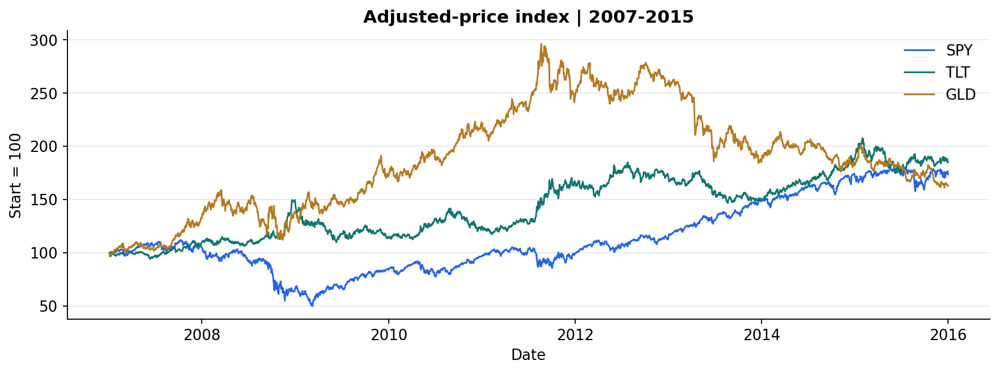
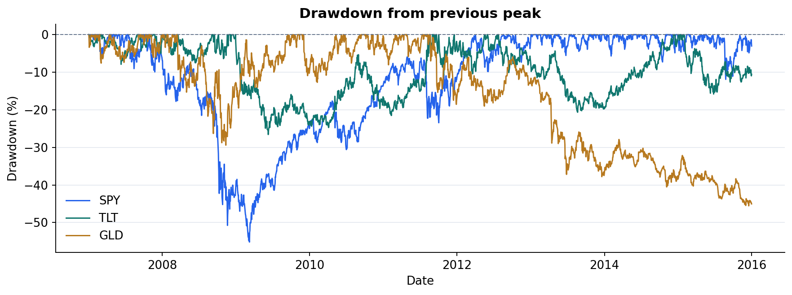
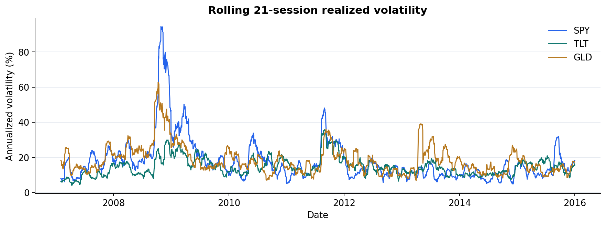
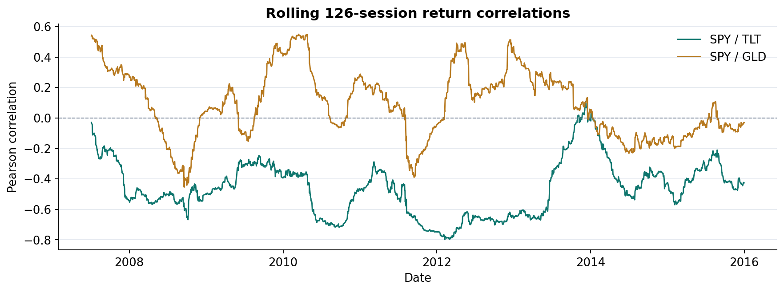
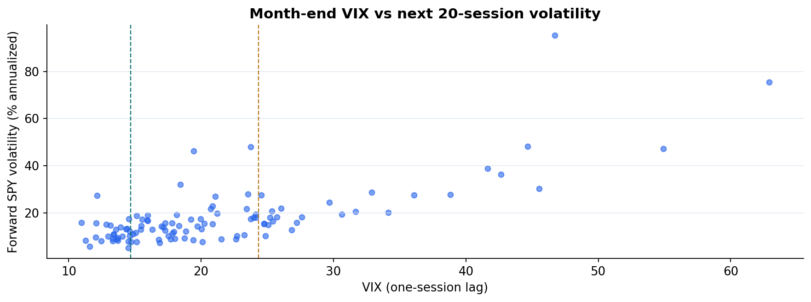
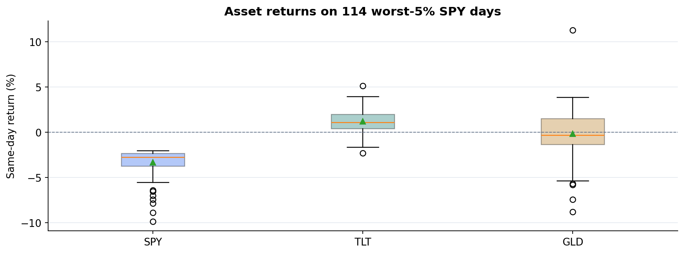

# SPY_analysis

An ETF allocation research project using SPY, TLT, GLD, VIX, and a short-term Treasury-rate proxy. The initial analysis asks how risk and diversification relationships change before defining a testable allocation rule.

**Development analysis:** 2007-01-03 through 2015-12-31, 2,266 sessions. Data from 2016 onward are reserved for later evaluation. The charts below describe assets; they do not show an AI strategy or prove outperformance.

## View the initial analysis

- [Notebook with saved chart outputs](notebooks/initial_analysis.ipynb): opens in VS Code and renders on GitHub without rerunning cells.
- [Written initial analysis](reports/primary_analysis.md): methods, observations, and limitations.
- [Interactive HTML report](reports/initial_analysis.html): open the local file in a browser for zooming, panning, and hover details. It is self-contained and works offline; GitHub displays HTML source rather than running it.
- [Strategy specification](docs/strategy_v1.md) and [development-only accounting check](reports/strategy_v1_dev_check.md).

## Chart gallery

### 1. Adjusted-price paths

All assets start at 100 to compare paths on a common scale. This is not a rebalanced portfolio.



### 2. Drawdown from previous peaks

Compare the depth and persistence of interim losses, including losses in candidate defensive assets.



### 3. Rolling realized volatility

Trailing 21-session volatility shows how the risk level changes within each asset.



### 4. Rolling diversification relationships

Correlations use trailing 126-session daily returns. Lower correlation is not a guarantee against joint losses.



### 5. VIX and subsequent realized risk

Each point is a month-end observation of one-session-lagged VIX, paired with SPY volatility over the next 20 sessions. This is descriptive, not a causal or return-direction result.



### 6. Stress-day outcomes

Distributions on the worst 5% of SPY days show that defensive candidates have different average and tail outcomes. The dates were selected after observing returns.



## Reproduce locally

Python 3.9 or later and curl are required. Data processing and the rule backtest use only the Python standard library.

```bash
python3 scripts/download_data.py
python3 scripts/primary_analysis.py
python3 scripts/backtest_strategy_v1.py
```

For interactive charts, exportable PNG/SVG figures, and the saved-output notebook:

```bash
python3 -m venv .venv
.venv/bin/python -m pip install -r requirements-visuals.txt
.venv/bin/python scripts/build_initial_analysis.py
```

On Windows, use `.venv\Scripts\python.exe` instead of `.venv/bin/python`. VS Code is configured to suggest the local environment. Choose it as the notebook kernel when rerunning cells.

## Data and provenance

ETF adjusted closes are retrieved from a [pinned secondary mirror of a Yahoo Finance cache](https://github.com/manisahni/marketdata/tree/65a079329e379e104495f459e12e76a8f995585a). VIX and rate observations are downloaded from [FRED VIXCLS](https://fred.stlouisfed.org/series/VIXCLS) and [FRED DGS3MO](https://fred.stlouisfed.org/series/DGS3MO).

Downloaded CSV files remain in the local data directories and are excluded from Git. Run the download script to reconstruct them. Source URLs, snapshot hashes, and coverage are recorded in [the data manifest](data/raw/sources.json). The report uses the locally saved snapshot and does not require an API call when viewing results.

`data/processed/market_daily.csv` contains date, three ETF adjusted closes, contemporaneous VIX/rate observations, and lagged VIX/rate inputs. Missing current Treasury-rate observations remain missing; lagged inputs carry the most recent prior observation. The first row has no lagged input.

Adjusted prices are return-analysis proxies rather than historical executable prices. A small number of source spot checks do not validate the entire ETF history. Full source cross-checking remains a requirement before final evaluation.

## Repository structure

```text
data/raw/                       Local downloads and tracked source manifest
data/processed/                 Locally generated daily input dataset
docs/strategy_v1.md              Initial rule specification
notebooks/initial_analysis.ipynb Saved-output analysis notebook
reports/initial_analysis.html   Offline interactive report
reports/figures/                 Exportable PNG and SVG charts
scripts/                        Download, analysis, chart, and backtest code
```

No live trading or brokerage connection is configured. Strategy results currently cover development data only.

See [GitHub connection](docs/git_setup.md) for local authentication and push instructions.

## Frozen strategy backtest

Run `.venv/bin/python scripts/build_backtest_report.py` after installing the visualization requirements. Read [the protocol and results](reports/backtest_v1.md), open [the interactive charts](reports/backtest_v1.html), or inspect [daily holdings and wealth](reports/backtest_v1_paths.csv). This run includes development, 2016–2017 validation, and the authorized 2018–2025 final test with unchanged strategy v1 rules. The final test is now observed and is no longer an unseen sample for future strategy revisions.

## Performance attribution and simple benchmarks

Run `.venv/bin/python scripts/analyze_performance.py` to reproduce [the accounting analysis](reports/performance_analysis.md) and [interactive charts](reports/performance_analysis.html). This retrospective diagnostic compares v1 with monthly SPY 40% / cash 60% and a VIX-equity/cash-only variant, and reconciles asset P&L with net returns. The underlying v1 results remain unchanged.

The attribution report also includes two monthly gold-inclusive static allocations and 0/5/20 bp cost scenarios. Their definitions and retrospective evaluation limits are recorded in [the static benchmark protocol](docs/static_benchmark_protocol.md).
