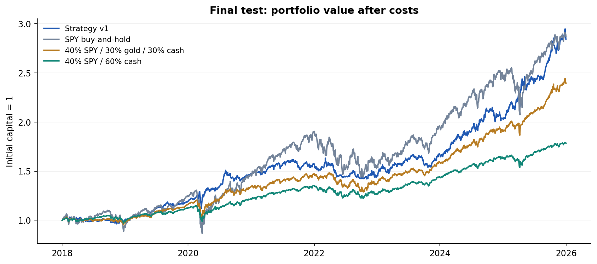
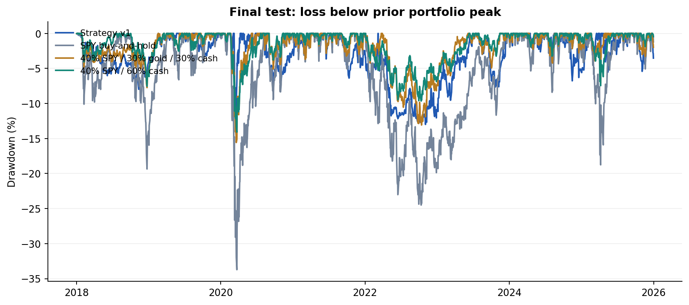
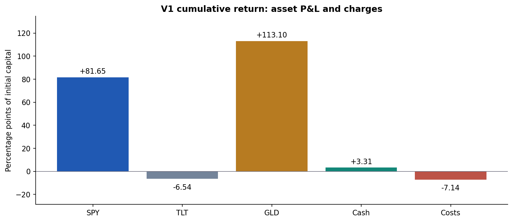
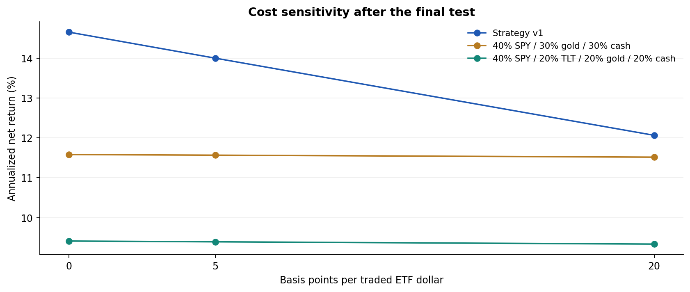

# SPY_analysis — Final research report

Reviewed 22 October 2026 · Rule-based allocation · Historical data through 31 December 2025


## 1. Research assessment


At 5 bp per traded dollar, v1 returned 14.00% annualized versus 14.15% for SPY, with maximum drawdowns of -13.32% and -33.72%. Annualized volatility was 10.51% versus 19.46%. At 20 bp, the respective annualized returns were 12.06% and 14.13%. These are historical comparisons; execution and data assumptions affect their interpretation.


The result is consistent with useful risk reduction in this historical sample. Lower equity exposure already provides substantial drawdown reduction, and gold accounts for much of v1’s cumulative gain. The study does not establish statistically significant alpha, causal value from each rule, or superiority to all static allocations. The implementation is a deterministic rule strategy; no AI or machine-learning model is trained.


This report closes the current research iteration. Final-test results have been observed, and all additional benchmark comparisons are retrospective. The remaining data and execution limitations are recorded below rather than treated as completed validation.


## 2. Data, motivation, and strategy


The locally saved dataset contains 4,780 trading sessions, 2007-01-03–2025-12-31. ETF adjusted closes come from a pinned secondary mirror of a Yahoo Finance cache. VIX and three-month Treasury yields come from FRED. Current VIX has no missing rows; current Treasury rates have 36 gaps. Lagged macro inputs carry only the latest earlier available value; the first row is unavailable.


The development analysis covers 2,266 sessions through 2015. Median next-20-session SPY volatility was 10.2% in the bottom lagged-VIX quartile and 20.7% in the top quartile (27 and 27 month-ends). This descriptive association motivates a risk input, not a return-direction forecast. The rule thresholds are experimental choices, not estimated optima.


| Component | Rule |
| --- | --- |
| Equity risk | Lagged VIX below the trailing 33rd percentile / between thresholds / above the 67th percentile maps to 65% / 40% / 15% SPY. Reference window: 252 sessions. |
| TLT eligibility | Positive trailing 63-session return and trailing 63-session SPY/TLT daily-return correlation below −0.15. |
| GLD eligibility | Positive trailing 63-session return. |
| Remainder | Divide equally between eligible TLT/GLD; use cash if neither qualifies. |
| Trading | Decide after trading Friday close; execute at the next session close. Skip when total absolute ETF-weight change is below 10 percentage points. Holiday Fridays are skipped. |


The final-test and validation portfolios each restart from cash. Their first close allocation uses the preceding session’s signal, an explicit boundary exception to the Friday schedule. Historical data before each evaluation start initialize signals. Subsequent returns are earned by holdings already in place before the current close’s trades.


## 3. Evaluation and accounting


| Stage | Dates | Interpretation |
| --- | --- | --- |
| Development | 2007–2015; portfolio from 2008-01-07 | Used to design rules; 252-session initialization. |
| Validation | 2016-01-04–2017-12-29 | Observed before final test; rules retained. |
| Final test | 2018-01-02–2025-12-31 | V1 rules retained; now observed. |
| Additional comparisons | Same 2018–2025 dates | Retrospective cash and gold-inclusive diagnostics. |


All portfolios use adjusted-close simple returns, fractional holdings, identical evaluation dates, and costs on both purchases and sales. The post-cost portfolio value solves V_after = V_before − cost_rate × Σ|target_weight × V_after − existing_ETF_value|. Initial purchases are charged; terminal liquidation is not. No external capital is added.


Cash accrues once per close-to-close interval at the previous row’s already lagged DGS3MO rate divided by 100 and 252. Relative to the return-end date, this normally uses a two-session-old rate, and older observations across source gaps. It is a conservative information lag and a yield-based proxy, not a tradable Treasury or deposit total return. Weekend calendar accrual is approximated by the trading-session convention.


Annualized return is final wealth raised to 252 divided by the number of close-to-close intervals, minus one. Volatility is sample standard deviation of daily net returns times √252. The initial purchase cost is included in final wealth and drawdown but excluded from the daily-volatility series. Maximum drawdown starts from initial capital 1. Rebalance counts refer to events, not individual ETF orders.


## 4. Final-test results


| Strategy | Annualized return | Volatility | Max drawdown | Mean SPY weight | Rebalances |
| --- | --- | --- | --- | --- | --- |
| Strategy v1 | 14.00% | 10.51% | -13.32% | 40.14% | 159 |
| SPY buy-and-hold | 14.15% | 19.46% | -33.72% | 100.00% | 1 |
| Monthly SPY 40% / cash 60% | 7.52% | 7.59% | -14.09% | 40.12% | 96 |
| VIX equity rule / cash only | 7.74% | 6.04% | -7.05% | 40.17% | 111 |
| Monthly SPY 40 / GLD 30 / cash 30 | 11.57% | 9.22% | -15.57% | 40.06% | 96 |
| Monthly SPY 40 / TLT 20 / GLD 20 / cash 20 | 9.39% | 8.87% | -18.34% | 40.12% | 96 |


The table uses 5 bp per traded dollar. Fixed portfolios rebalance monthly. The two gold-inclusive targets use 40% SPY and divide the remainder equally across GLD/cash or TLT/GLD/cash. These weights were defined before their own runs but after the original final-test results had been seen. They are not an exact volatility or full-exposure match for v1.




2018-01-02–2025-12-31. All portfolios use 5 bp costs per traded ETF dollar, including their initial purchase. Static allocations rebalance monthly.




2018-01-02–2025-12-31. All portfolios use 5 bp costs per traded ETF dollar, including their initial purchase. Static allocations rebalance monthly.


V1 and the monthly 40% SPY benchmark have mean equity weights of 40.14% and 40.12%. Their annualized returns are 14.00% and 7.52%, volatility 10.51% and 7.59%, and maximum drawdowns -13.32% and -14.09%. The fixed benchmark provides a direct check on how much drawdown reduction is available from lower equity exposure alone. It is not a causal decomposition of v1.


## 5. Where gains and losses arose




Contributions add to +184.38% cumulative net return. They are not contributions to annualized return and do not estimate causal effects.


GLD contributed +113.10 percentage points to v1's +184.38% cumulative net return; SPY contributed +81.65 points, TLT -6.54, cash +3.31, and charges -7.14. These contributions add to the cumulative return, not CAGR. The cash-only VIX variant returned 7.74% annualized with a -7.05% maximum drawdown.


In 2020, v1's calendar return was +24.04%, including +13.08 points from GLD. In 2022, v1 returned -7.70%, versus -6.08% for the fixed equity/cash benchmark. During the retrospectively selected 2020 v1 drawdown window 2020-03-09 to 2020-03-18, TLT and GLD contributed -7.32 and -4.47 points. During the 2022 v1 drawdown window 2022-03-08 to 2022-11-03, GLD contributed -9.71 points. Full-year returns include recoveries and should not be used to describe peak-to-trough protection.


| Year | Portfolio | Calendar return | Within-year max drawdown |
| --- | --- | --- | --- |
| 2020 | Strategy v1 | +24.04% | -13.32% |
| 2020 | SPY buy-and-hold | +18.33% | -33.72% |
| 2020 | Monthly SPY 40% / cash 60% | +8.47% | -14.09% |
| 2022 | Strategy v1 | -7.70% | -12.99% |
| 2022 | SPY buy-and-hold | -18.18% | -24.50% |
| 2022 | Monthly SPY 40% / cash 60% | -6.08% | -9.65% |


Calendar-year returns begin at the preceding year-end close. Within-year drawdowns reset the high-water mark there. Asset contributions sum dollar P&L and divide by period-start capital, with costs shown separately. Later gains on reinvested profits belong to the asset holding that capital. Selected peak-to-trough dates are v1’s worst interval within the year; they are not each benchmark’s own worst interval. The cash-only VIX variant also changes the no-trade decisions, because defensive ETF turnover disappears, so it is not a clean single-rule ablation.


## 6. Costs and robustness limits




Aggregate friction scenarios apply to buys and sells. No separate spread, market impact, tax, or additional execution-delay simulation is included.


At 5 bp, the SPY/GLD/cash static portfolio returned 11.57% annualized with 9.22% volatility and a -15.57% maximum drawdown. The four-asset static portfolio returned 9.39%, with 8.87% volatility and a -18.34% drawdown. At 20 bp, v1 returned 12.06% versus 11.52% for SPY/GLD/cash, a gap of 0.55 percentage points. The weights were documented before these benchmark runs, after the original final-test results had been observed. No weight search was performed; this remains a retrospective comparison.


Testing a few static portfolios does not exhaust the alternatives. No formal significance test, confidence interval for excess performance, or correction for repeated strategy comparisons is reported. An extra-session execution delay, raw-price tradable execution, broader parameter stability checks, and a full independent price-history comparison remain unperformed. These are limitations of the completed study, not evidence that the strategy would or would not survive them.


## 7. Review, corrections, and checks


| Finding | Correction or disposition |
| --- | --- |
| Stale evaluation status | Updated initial-analysis and README wording to reflect completed validation and final testing. |
| Hardcoded result prose | Narrative figures now come from the same results as the tables, preventing silent disagreement after reruns. |
| Mutable redownloads | Cached source files are verified against the manifest; changing the snapshot requires explicit refresh. An absent cache must match recorded hashes or fail. |
| Input assumptions | The engine rejects unknown modes, invalid costs, too-short runs, nonfinite prices/macro values, and unordered dates. Signal warmup is enforced. |
| Cash timing ambiguity | Documented the prior row’s already lagged input explicitly; historical accounting is preserved. |
| Source and execution limits | Recorded as unresolved. No claim of fully verified ETF history or executable investment performance. |


The review pipeline passed 8 focused automated tests, plus source/processed hash checks, daily and period P&L reconciliation, historical-prefix checks, and a comparison against the previously saved backtest metrics. Published backtest numerical results were unchanged: true. Tests cover intended mechanics, not profitability or source truth.


The preserved processed-data SHA-256 is 0d386c47dfd4aa3eaff736086ab94cda93775df9d406808441adf2167cbb4f7a. A checksum identifies a snapshot; it cannot certify that its market prices are correct. FRED downloads are current historical series, not a full point-in-time vintage archive. A lag alone cannot remove any later data revisions.


## 8. Conclusion


V1 is a reproducible allocation experiment with historical annualized return 14.00%, volatility 10.51%, and maximum drawdown -13.32% in the final sample at 5 bp. Its main research contribution is an explicit, inspectable link between risk signals, changing holdings, trading costs, and asset-level P&L.


The evidence supports a narrower conclusion than “the strategy beats the market”: lower equity exposure accounts for substantial risk reduction, gold exposure contributes much of the realized gain, and trading costs reduce the advantage over simple gold-inclusive allocations. Defensive assets also caused sizable interim losses. The project is complete as a historical research prototype; deployment readiness has not been established.


## 9. Reproduction and supporting material


Create a virtual environment, install requirements-visuals.txt, and run .venv/bin/python scripts/rebuild_project.py. The default uses verified cached downloads; a fresh clone attempts to recover the recorded bytes. If mutable FRED data no longer match the manifest, exact reproduction requires the original saved snapshot. Explicit --refresh in download_data.py creates a new data snapshot and must be treated as a new data revision.


```bash
python3 -m venv .venv
.venv/bin/python -m pip install -r requirements-visuals.txt
.venv/bin/python scripts/rebuild_project.py
python3 -m http.server 8765 --bind 127.0.0.1 --directory reports
```


- [Initial analysis](initial_analysis.html)
- [Backtest details](backtest_v1.html)
- [Attribution and all benchmark charts](performance_analysis.html)
- [Review checks](review_checks.json)


Figures are available as PNG and SVG under reports/figures/final_*. The HTML report embeds its figures and can be read offline; supporting links require the adjacent project files. Raw and processed CSV downloads are excluded from Git. No live brokerage or scheduled trading process is configured.


## 10. Sources and provenance


- [Pinned ETF data mirror](https://github.com/manisahni/marketdata/tree/65a079329e379e104495f459e12e76a8f995585a)


- [FRED VIXCLS](https://fred.stlouisfed.org/series/VIXCLS)


- [FRED DGS3MO](https://fred.stlouisfed.org/series/DGS3MO)


The source manifest records URLs, retrieval time, raw-file hashes, and the processed-data hash. The original seed paper was not used as the strategy specification; the implemented rules and evaluation history are documented in this repository.
